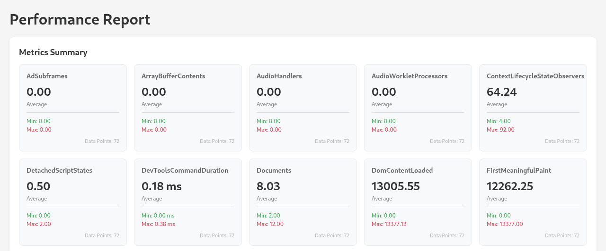
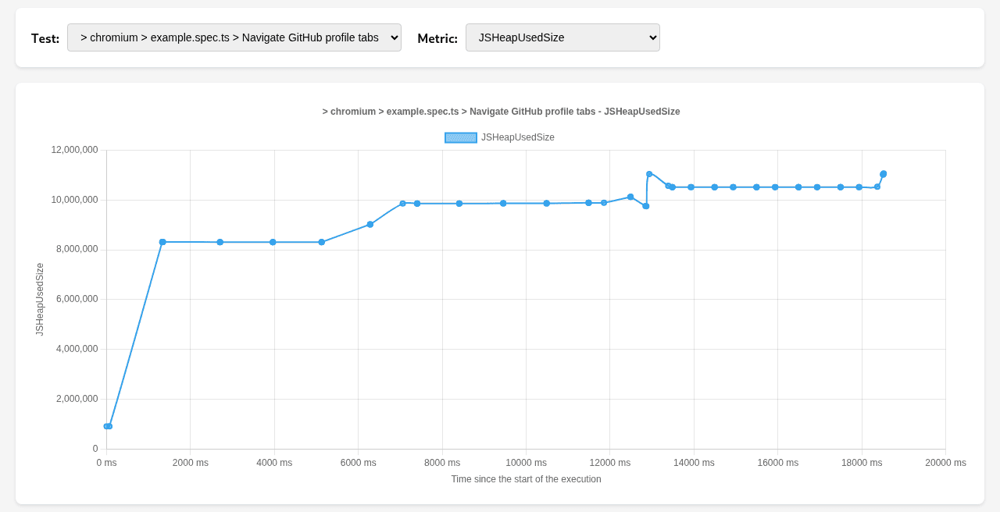
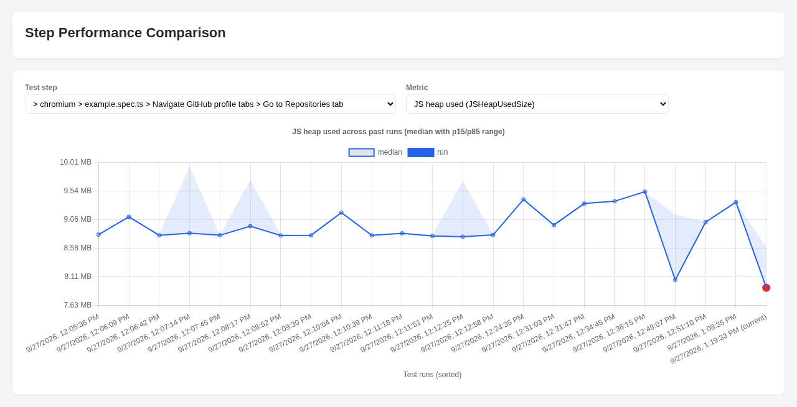

# playwright-performance-reporter

[](https://github.com/ntrotner/playwright-performance-reporter/actions/workflows/release.yml)
[](https://codecov.io/github/ntrotner/playwright-performance-reporter)
[](https://www.npmjs.com/package/playwright-performance-reporter)

> A Playwright reporter that collects performance metrics from the browser dev tools (Chrome DevTools Protocol) while your tests run, and writes them as JSON, interactive HTML charts and run-over-run regression reports.

- **No test instrumentation.** The reporter collects metrics per `test()` and per `test.step()`. Your specs need no extra code.
- **Built-in observers.** JS heap, CDP performance counters, CPU profile summary, Web Vitals, navigation timing (TTFB), network activity, heap snapshots and allocation sampling.
- **Budgets.** Fail the run when a metric crosses a threshold, e.g. LCP above 2.5 s.
- **Sampling.** Polls metrics at a fixed interval during long tests and steps.
- **Presenters.** Streamed JSON, timeline JSON, a Chart.js HTML report and a comparison against previous runs.
- **Extensible.** Add your own observer for any CDP call, or your own presenter for any output format.

## Contents

- [Showcase](#showcase)
- [Install](#install)
- [Quick start](#quick-start)
- [How it works](#how-it-works)
- [Configuration reference](#configuration-reference)
- [Chromium observers](#chromium-observers)
- [Presenters](#presenters)
- [Output format](#output-format)
- [Extending](#extending)
- [Browser support and limitations](#browser-support-and-limitations)
- [Troubleshooting / FAQ](#troubleshooting--faq)
- [For AI agents and contributors](#for-ai-agents-and-contributors)

## Showcase

The screenshots and snippets below come from the runnable simulation in [`example/`](example/) (`cd example && npm run test`).

### `chartPresenter`: interactive HTML report

The report shows a summary card (average, min, max, data points) for every numeric metric of the selected test:



It also has a timeline chart for any test and metric, with one line per test execution:



### `comparisonPresenter`: regression tracking across runs

It plots each test step and metric across all stored runs. The plot shows the per-run median, a percentile band, and the current run highlighted. A machine-readable verdict goes into a JSON report.



### `jsonChunkPresenter`: raw data export

This is the stop measurement of a `test.step('Open profile', ...)`. It is trimmed: there are 36 `allPerformanceMetrics` keys, and only a few are shown. The full schema is under [Output format](#output-format).

```json
[
  {
    "a30a6eba6312f6b87ea5-0d3741cd336b023b92f5": {
      "f4680568daecac45b5b5db3d4d7684ee": {
        "name": "Open profile",
        "startMetrics": [],
        "stopMetrics": [
          {
            "metric": { "Nodes": 7951, "LayoutCount": 12, "ScriptDuration": 0.270781, "TaskDuration": 0.979239, "JSHeapUsedSize": 8311228, "JSHeapTotalSize": 14450688 },
            "id": "477964E0C1FD6E5AF8D103988E967CB4",
            "type": "page",
            "title": "ntrotner (Nikita Trotner) · GitHub",
            "url": "https://github.com/ntrotner"
          },
          {
            "metric": { "cpuProfileDuration": 1264.311, "cpuProfileSampleCount": 1161, "cpuProfileActiveTime": 974.427, "cpuProfileScriptTime": 366.587, "cpuProfileGarbageCollectorTime": 13.046, "cpuProfileProgramTime": 594.794, "cpuProfileIdleTime": 285 },
            "id": "477964E0C1FD6E5AF8D103988E967CB4",
            "type": "page",
            "url": "https://github.com/ntrotner"
          },
          {
            "metric": { "largestContentfulPaint": 1380, "firstContentfulPaint": 1216, "cumulativeLayoutShift": 0.0000069, "interactionToNextPaint": 0 },
            "id": "477964E0C1FD6E5AF8D103988E967CB4",
            "type": "page",
            "url": "https://github.com/ntrotner"
          }
        ],
        "samplingMetrics": [],
        "startMeasurement": 1790507976250,
        "endMeasurement": 1790507976269,
        "endMeasurementOffset": 19
      }
    }
  }
]
```

## Install

```bash
npm install --save-dev playwright-performance-reporter
# or
yarn add --dev playwright-performance-reporter
```

Requirements:

- Node.js `>= 20`
- `@playwright/test`
- Chromium. Other browsers run, but no metrics are collected for them (see [limitations](#browser-support-and-limitations)).

The package is ESM-only (`"type": "module"`).

## Quick start

This is a complete `playwright.config.ts`. Three parts are required:

1. `workers: 1` and `fullyParallel: false`. All browsers would share one debugging port.
2. A project whose `use` comes from a `devices[...]` preset. The preset sets `defaultBrowserType`, and the reporter uses it to detect the browser.
3. `--remote-debugging-port=<port>` in `launchOptions.args`. The reporter reads the port from there.

```ts
// playwright.config.ts
import {defineConfig, devices} from '@playwright/test';
import {nativeChromiumObservers, nativePresenters, type Options} from 'playwright-performance-reporter';

const performanceReporterOptions: Options = {
  deleteOnFailure: false,
  presenters: [
    new nativePresenters.jsonChunkPresenter({outputDir: './', outputFile: 'performance.json'}),
    new nativePresenters.chartPresenter({outputDir: './', outputFile: 'performance.html'}),
  ],
  browsers: {
    chromium: {
      onTestStep: {
        metrics: [new nativeChromiumObservers.allPerformanceMetrics()],
      },
      sampling: {
        metrics: [{samplingTimeoutInMilliseconds: 1000, metric: new nativeChromiumObservers.usedJsHeapSize()}],
      },
    },
  },
};

export default defineConfig({
  testDir: './tests',
  fullyParallel: false,
  workers: 1,
  reporter: [
    ['list'],
    ['playwright-performance-reporter', performanceReporterOptions],
  ],
  projects: [
    {
      name: 'chromium',
      use: {
        ...devices['Desktop Chrome'],
        launchOptions: {
          args: ['--remote-debugging-port=9222'],
        },
      },
    },
  ],
});
```

Step metrics are only recorded for `test.step()` blocks:

```ts
// tests/example.spec.ts
import {test} from '@playwright/test';

test('open profile', async ({page}) => {
  await test.step('Navigate', async () => {
    await page.goto('https://github.com/ntrotner');
  });
});
```

Run `npx playwright test`. You get `performance.json` and `performance.html` in the working directory.

A more complete setup is in [`example/playwright.config.ts`](example/playwright.config.ts). It configures all four presenters, sampling, CPU profiling, Web Vitals and network activity.

## How it works

```text
onTestBegin   ─► run `onTest.metrics`      onStart    ─► chunk with startMetrics  ─┐
                 start sampling timers                                             │
onStepBegin   ─► run `onTestStep.metrics`  onStart    ─► chunk with startMetrics   │
every N ms    ─► run `sampling.metrics`    onSampling ─► chunk with samplingMetrics├─► every presenter.write(chunk)
onStepEnd     ─► run `onTestStep.metrics`  onStop     ─► chunk with stopMetrics    │
onTestEnd     ─► run `onTest.metrics`      onStop     ─► chunk with stopMetrics   ─┘
onEnd         ─► presenter.close(); and presenter.delete() if the run failed and deleteOnFailure is true
```

- The reporter connects to the browser over CDP on the port from `launchOptions.args`. It measures **every CDP target**: pages, iframes, workers and so on. Each target becomes one `TargetMetric` entry.
- Before an observer is called on a target, the observer's `plugins` run on that target, for example to enable a CDP domain or force garbage collection.
- Every measurement is written to all presenters right away as a small chunk (`ResultAccumulator`). Presenters merge or stream the chunks.

## Configuration reference

The options are the second element of the reporter tuple: `['playwright-performance-reporter', options]`. They are typed as `Options` ([`src/types/options.ts`](src/types/options.ts)).

### `Options`

| Field             | Type                | Required | Default                                                          | Description                                                                                                                                                                                 |
|-------------------|---------------------|----------|------------------------------------------------------------------|---------------------------------------------------------------------------------------------------------------------------------------------------------------------------------------------|
| `browsers`        | `BrowserOptions`    | yes      | none                                                             | Observers per browser and hook. See below.                                                                                                                                                  |
| `deleteOnFailure` | `boolean`           | yes      | none                                                             | If the Playwright run status is not `passed`, call `delete()` on every presenter. This removes the generated files.                                                                         |
| `presenters`      | `PresenterWriter[]` | no       | one `jsonChunkPresenter` writing `./performance-report-<epochMs>.json` | Output writers. Every chunk is sent to every presenter.                                                                                                                                     |
| `budgets`         | `BudgetOptions`     | no       | none (purely passive)                                            | Performance budgets checked against the final (`onStop`) metrics. A violation fails the run by default. See [Budgets](#budgets).                                                           |
| `maxListeners`    | `number`            | no       | Node default (`10`)                                              | Sets `EventEmitter.setMaxListeners()` globally. Raise it if many presenters cause a `MaxListenersExceededWarning`. `0` removes the limit.                                                  |

`defaultOptions` is exported as a ready-made starting point. It runs `allPerformanceMetrics` on `onTest` and samples `usedJsHeapSize` every 1000 ms. It is **not** applied automatically, so you have to pass it yourself: `['playwright-performance-reporter', defaultOptions]`.

### `browsers`

```ts
type BrowserOptions = {
  [browser in 'chromium' | 'firefox' | 'webkit']?: {
    onTest?: {metrics: MetricObserver[]};       // measured at test begin and end
    onTestStep?: {metrics: MetricObserver[]};   // measured at test.step() begin and end
    sampling?: {
      metrics: Array<{
        samplingTimeoutInMilliseconds: number;  // interval of setInterval()
        metric: MetricObserver;
      }>;
    };
  };
};
```

| Key          | When observers run                                                                    | Written to                                                                    |
|--------------|---------------------------------------------------------------------------------------|-------------------------------------------------------------------------------|
| `onTest`     | `onStart` at test begin, `onStop` at test end                                         | `startMetrics` / `stopMetrics` of the `TEST_CASE_PARENT` entry                |
| `onTestStep` | `onStart` at `test.step()` begin, `onStop` at its end. Only steps of category `test.step`. | `startMetrics` / `stopMetrics` of the step entry                              |
| `sampling`   | `onSampling` every `samplingTimeoutInMilliseconds`, while a test or step is running   | `samplingMetrics` of the step (or test) that is active at that moment         |

Only `chromium` collects data today. The `firefox` and `webkit` keys are accepted, but those clients return no metrics.

> `onTest` start and stop measurements are often empty. At test begin, the page under test may not exist yet. At test end, it is already closed. For reliable data, use `onTestStep` and `sampling`.

> Observers can keep state between calls. For example, `cpuProfiler` holds a lock and `networkActivity` keeps running counters. Use a **separate instance** for each hook and for each sampling entry, as in [`example/playwright.config.ts`](example/playwright.config.ts).

### Sampling

Start and stop values alone are inaccurate for long steps. Sampling adds intermediate points:

```ts
import {nativeChromiumObservers, type Options} from 'playwright-performance-reporter';

const options: Options = {
  deleteOnFailure: false,
  browsers: {
    chromium: {
      onTestStep: {
        metrics: [new nativeChromiumObservers.usedJsHeapSize()],
      },
      sampling: {
        metrics: [
          {samplingTimeoutInMilliseconds: 1000, metric: new nativeChromiumObservers.allPerformanceMetrics()},
          {samplingTimeoutInMilliseconds: 1000, metric: new nativeChromiumObservers.networkActivity({includeDetailsInSampling: false, triggerGarbageCollectionOnObserve: false})},
        ],
      },
    },
  },
};
```

### Budgets
Budgets turn measured metrics into a pass/fail gate. Each rule is checked against the final (`onStop`) metrics
of every test and step. By default, a violation sets the status of the run to `failed`, so Playwright exits with a non-zero code.

```ts
const PlaywrightPerformanceReporterOptions: Options = {
  ...
  budgets: {
    onViolation: 'fail', // default, use 'warn' to only log violations
    rules: [
      {metric: 'largestContentfulPaint', max: 2500},
      {metric: 'totalNetworkDuration', max: 3000},
      {metric: 'JSHeapUsedSize', max: 120 * 1024 * 1024},
      // Scope a rule with a glob (`*` and `?`) on the test or step name
      {metric: 'cumulativeLayoutShift', max: 0.1, namePattern: '*checkout*'},
    ],
  },
}
```

- `metric`: key of the metric as written in `stopMetrics[].metric`
- `max` / `min`: fail if any matching value is above / below the bound (at least one is required)
- `namePattern`: glob matched against the name of the test or step, e.g. `" > chromium > profile.spec.ts > Profile"` (default `*`)

A violation is logged as `Budget violation: metric "largestContentfulPaint" = 3120.5 > 2500 (ms) (test: "...")`.
Invalid rules throw when the reporter is created. A metric that was never measured only logs a warning, so make sure
the observer emitting it is registered in `onTest` or `onTestStep`. Sampling metrics are not evaluated.
Every retry is evaluated as well, and with `deleteOnFailure: true` a violation deletes the report like any other failure.

Values are compared in the native unit of the metric:

| Metric | Unit |
|---|---|
| `largestContentfulPaint`, `firstContentfulPaint`, `interactionToNextPaint`, `totalNetworkDuration` | milliseconds |
| `cumulativeLayoutShift` | score |
| `*Size`, `*Bytes`, e.g. `JSHeapUsedSize`, `usedJsHeapSize`, `totalNetworkTransferSize` | bytes |
| Other `*Duration` / `*Time` of `allPerformanceMetrics`, e.g. `ScriptDuration`, `TaskDuration` | seconds |
| Everything else, e.g. `Nodes`, `totalNetworkRequests` | count |

## Chromium observers

The observers are available as `nativeChromiumObservers.<name>`. Each one is a class, so create instances with `new`. The sources are in [`src/browsers/chromium/observers/`](src/browsers/chromium/observers/).

| Observer                | Measures                                                                                                                                         | Output keys in `metric`                                                                                                                                                                                                                                                                                       | Units                                                                                                                                         | Hooks with data                       | Constructor options                                                                  |
|-------------------------|--------------------------------------------------------------------------------------------------------------------------------------------------|---------------------------------------------------------------------------------------------------------------------------------------------------------------------------------------------------------------------------------------------------------------------------------------------------------------|-----------------------------------------------------------------------------------------------------------------------------------------------|---------------------------------------|--------------------------------------------------------------------------------------|
| `allPerformanceMetrics` | All counters of CDP [`Performance.getMetrics`](https://chromedevtools.github.io/devtools-protocol/tot/Performance/#method-getMetrics)            | `Timestamp`, `Documents`, `Frames`, `JSEventListeners`, `LayoutObjects`, `Nodes`, `Resources`, `LayoutCount`, `RecalcStyleCount`, `LayoutDuration`, `RecalcStyleDuration`, `ScriptDuration`, `V8CompileDuration`, `TaskDuration`, `TaskOtherDuration`, `ThreadTime`, `ProcessTime`, `JSHeapUsedSize`, `JSHeapTotalSize`, `DomContentLoaded`, `NavigationStart`, … (whatever Chromium reports) | Counts. `*Duration`/`*Time`: **seconds**. `JSHeap*`: bytes. `Timestamp`, `DomContentLoaded`, `NavigationStart`: monotonic seconds | start, sampling, stop                 | `ObserverOptions`                                                                    |
| `usedJsHeapSize`        | Used JS heap (`JSHeapUsedSize`)                                                                                                                  | `usedJsHeapSize`                                                                                                                                                                                                                                                                                              | bytes                                                                                                                                         | start, sampling, stop                 | `ObserverOptions`                                                                    |
| `totalJsHeapSize`       | Total JS heap (`JSHeapTotalSize`)                                                                                                                | `totalJsHeapSize`                                                                                                                                                                                                                                                                                             | bytes                                                                                                                                         | start, sampling, stop                 | `ObserverOptions`                                                                    |
| `cpuProfiler`           | V8 CPU profile between start and stop, summarized by category                                                                                    | `cpuProfileDuration`, `cpuProfileSampleCount`, `cpuProfileActiveTime`, `cpuProfileScriptTime`, `cpuProfileGarbageCollectorTime`, `cpuProfileProgramTime`, `cpuProfileIdleTime`                                                                                                                              | ms (`cpuProfileSampleCount`: count)                                                                                                           | stop (start begins profiling)         | `{samplingIntervalInMicroseconds?: number /* 1000 */, triggerGarbageCollectionOnObserve?: boolean /* true */}` |
| `webVitals`             | Web Vitals from a persistent in-page `PerformanceObserver`                                                                                       | `largestContentfulPaint`, `firstContentfulPaint`, `cumulativeLayoutShift`, `interactionToNextPaint`                                                                                                                                                                                                          | ms since the page's time origin, CLS is a unitless score. `0` = not observed yet                                                                     | start, sampling, stop                 | none                                                                                 |
| `navigationTiming`      | [Navigation Timing](https://developer.mozilla.org/en-US/docs/Web/API/PerformanceNavigationTiming) of the current document via `Runtime.evaluate` | `timeToFirstByte`, `redirectTime`, `dnsLookupTime`, `tcpConnectTime`, `tlsTime`, `requestTime` (server response time), `responseTime` (download), `domContentLoadedTime`, `domCompleteTime`, `loadEventTime`, `nextHopProtocol`, `navigationTransferSize`, `navigationEncodedBodySize`, `navigationDecodedBodySize` | ms (`timeToFirstByte` and load milestones since the navigation start), sizes in bytes, `nextHopProtocol` is a string | start, sampling, stop | `{includeSizes?: boolean /* true */, includeLoadMilestones?: boolean /* true */}`: `false` drops the size/protocol keys or the load milestone keys |
| `networkActivity`       | Requests seen via the CDP `Network` domain, counted from the first time this instance observed a target                                          | `totalNetworkRequests`, `totalNetworkTransferSize`, `totalNetworkDuration`, `networkActivities` (array of `{requestId, url, method, status?, transferSize?, duration?, timestamp}`)                                                                                                                          | count, bytes (encoded), ms (sum of request durations)                                                                                         | start, sampling, stop                 | `{includeDetailsInSampling?: boolean /* false */, triggerGarbageCollectionOnObserve: boolean /* required by the type, ignored */}`: if `includeDetailsInSampling` is `false`, `networkActivities` is `[]` while sampling |
| `heapDump`              | Full heap snapshot (`HeapProfiler.takeHeapSnapshot`)                                                                                             | `heap`                                                                                                                                                                                                                                                                                                        | string (`.heapsnapshot` JSON). **Very large**                                                                                                 | start, sampling, stop                 | `ObserverOptions`                                                                    |
| `heapProfilerSampling`  | Sampling heap profile between start and stop                                                                                                     | `heapProfilerSampling`                                                                                                                                                                                                                                                                                        | string (JSON of `HeapProfiler.SamplingHeapProfile`)                                                                                           | stop (start begins sampling)          | `ObserverOptions`                                                                    |
| `heapObjectsTracking`   | Allocation tracking between start and stop (`HeapProfiler.startTrackingHeapObjects`)                                                            | `heapObjectsTracking`                                                                                                                                                                                                                                                                                         | string (heap snapshot chunks). **Very large**                                                                                                 | stop (start begins tracking)          | `ObserverOptions`                                                                    |

`ObserverOptions` is `{triggerGarbageCollectionOnObserve: boolean}`. The whole argument is optional, but if you pass an object, the field is required. When it is `true`, the `heapGarbageCollectorPlugin` (`HeapProfiler.collectGarbage`) runs before every measurement. This makes heap values comparable. The option defaults to off, except for `cpuProfiler`, where it defaults to `true`. `networkActivity` requires the field in its options type, but ignores it.

Usage:

```ts
new nativeChromiumObservers.allPerformanceMetrics({triggerGarbageCollectionOnObserve: true});
new nativeChromiumObservers.cpuProfiler({samplingIntervalInMicroseconds: 500, triggerGarbageCollectionOnObserve: false});
new nativeChromiumObservers.networkActivity({includeDetailsInSampling: true, triggerGarbageCollectionOnObserve: false});
new nativeChromiumObservers.webVitals();
new nativeChromiumObservers.navigationTiming({includeSizes: false});
```

Notes:

- `cpuProfiler`, `heapProfilerSampling` and `heapObjectsTracking` measure a time range. Register them in `onTest` or `onTestStep`, **not** in `sampling`, because their `onSampling` does nothing. Register `cpuProfiler` in only one hook. The profiler is started and stopped per target, so profiling from both hooks at once interferes.
- `navigationTiming` describes the latest navigation, so a step without navigation reports the previous document. Cross-origin documents without a `Timing-Allow-Origin` header report most phases as `0`.
- `heapDump` and `heapObjectsTracking` produce strings of many MB per target. Use them sparingly.

### Plugins

`nativeChromiumPlugins` are `(client: CDP.Client) => Promise<any>` functions that observers list in `plugins`. They run before each measurement, in order, and their errors are swallowed.

| Plugin                       | CDP call                     |
|------------------------------|------------------------------|
| `performanceDomainPlugin`    | `Performance.enable`         |
| `heapProfilerDomainPlugin`   | `HeapProfiler.enable`        |
| `profilerDomainPlugin`       | `Profiler.enable`            |
| `networkDomainPlugin`        | `Network.enable`             |
| `heapGarbageCollectorPlugin` | `HeapProfiler.collectGarbage` |

## Presenters

The presenters are available as `nativePresenters.<name>`. The sources are in [`src/presenters/`](src/presenters/).

| Presenter               | Output                                                                                     | Constructor options                                  |
|-------------------------|--------------------------------------------------------------------------------------------|------------------------------------------------------|
| `jsonChunkPresenter`    | JSON array of every chunk, streamed to disk ([format](#json-chunk-format))                 | `{outputDir: string; outputFile: string}`            |
| `timelineDataPresenter` | JSON array of numeric data points, timestamps relative to each execution ([format](#timeline-data-format)) | `{outputDir: string; outputFile: string}` |
| `chartPresenter`        | Self-contained HTML report (Chart.js) with summary cards and a timeline per test and metric | `{outputDir: string; outputFile: string}`            |
| `comparisonPresenter`   | Stores each run in a history folder and compares the latest runs against a baseline. Writes HTML and JSON ([format](#comparison-report-format)) | `Partial<ComparisonPresenterOptions>`, see below |

`jsonChunkPresenter`, `timelineDataPresenter` and `chartPresenter` open their file in the constructor. Make sure `outputDir` exists. `comparisonPresenter` creates its folders itself.

### `comparisonPresenter`

```ts
new nativePresenters.comparisonPresenter({
  historyDir: './performance-history', // required: one json chunk file per run is stored here
  outputDir: './',                     // required: where the reports are written
});
```

| Option                   | Type                           | Default                                                                                                             | Description                                                                                                                 |
|--------------------------|--------------------------------|---------------------------------------------------------------------------------------------------------------------|-----------------------------------------------------------------------------------------------------------------------------|
| `historyDir`             | `string`                       | none (required)                                                                                                     | Folder with the JSON chunk files of all previous runs. The current run is written there as `<runFilePrefix>-<ISO time>.json`. |
| `outputDir`              | `string`                       | none (required)                                                                                                     | Folder for the reports.                                                                                                     |
| `runFilePrefix`          | `string`                       | `'performance-run'`                                                                                                 | File name prefix of the current run in `historyDir`.                                                                        |
| `visualReportOutputFile` | `string`                       | `'performance-comparison.html'`                                                                                     | HTML report file name.                                                                                                      |
| `jsonReportOutputFile`   | `string`                       | `'performance-comparison.json'`                                                                                     | JSON report file name.                                                                                                      |
| `requiredMetrics`        | `string[]`                     | `['JSHeapUsedSize', 'TaskDuration', 'ScriptDuration', 'totalNetworkRequests', 'totalNetworkTransferSize', 'cpuProfileActiveTime']` | A run is compared only if it contains all of these metrics. The defaults need `allPerformanceMetrics`, `networkActivity` and `cpuProfiler`. |
| `comparedMetrics`        | `string[]`                     | every metric of a run                                                                                               | Restrict the compared metrics. `entityDuration` (wall time of the test or step, ms) is always compared.                      |
| `bandPercentile`         | `number` (0 to 0.5)            | `0.05`                                                                                                              | Lower band percentile of the chart. The upper band is `1 - bandPercentile`.                                                  |
| `recentRuns`             | `number`                       | `3`                                                                                                                 | Up to N latest runs, including the current one. Their median is compared.                                                    |
| `baselineWindow`         | `number`                       | `20`                                                                                                                | Number of runs before the recent runs that form the baseline.                                                               |
| `relativeThreshold`      | `number`                       | `0.1`                                                                                                               | Minimum relative change to report (0.1 = 10 %).                                                                             |
| `zScoreThreshold`        | `number`                       | `2`                                                                                                                 | Minimum robust z-score (change / scaled MAD of the baseline) to report.                                                     |
| `minBaselineRuns`        | `number`                       | `3`                                                                                                                 | With fewer baseline runs, the report is `low-confidence` and only `relativeThreshold` applies.                              |
| `runSortValue`           | `(run: RunSummary) => number`  | `run => run.startedAt`                                                                                              | Order of runs on the chart's x-axis.                                                                                        |
| `runLabel`               | `(run: RunSummary) => string`  | `run => new Date(run.startedAt).toLocaleString()`                                                                   | Label of runs on the chart's x-axis.                                                                                        |

The workflow has four steps:

1. Run the suite once. The report status is `no-baseline`, and this run becomes the baseline.
2. Keep the `historyDir` between runs, for example as a cached CI artifact.
3. Runs 2 to 3 report `low-confidence`.
4. From `minBaselineRuns + 1` runs on, noise is separated from real changes.

Tests are matched across runs by the Playwright test id. Steps are matched by test id, step name and occurrence.

## Output format

All types are exported from the package root and live in [`src/types/`](src/types/).

### JSON chunk format

`jsonChunkPresenter` writes `ResultAccumulator[]`. Every chunk holds one measurement. To get the full picture of a test, merge all chunks with the same keys.

```ts
type ResultAccumulator = Record<
  string,                       // test case id (Playwright test.id)
  Record<
    string,                     // 'TEST_CASE_PARENT' for the test itself, otherwise md5(step title path + start time)
    TestPerformance
  >
>;

type TestPerformance = {
  name: string;                 // test: title path joined by ' > ', step: step title path (nested steps joined by ' > ')
  startMeasurement: number;     // Unix ms
  startMeasurementOffset?: number; // ms the onStart observers took
  endMeasurement: number;       // Unix ms
  endMeasurementOffset?: number;   // ms the onStop / onSampling observers took
  startMetrics: TargetMetric[];
  stopMetrics: TargetMetric[];
  samplingMetrics: TargetMetric[];
};

type TargetMetric = {
  metric: Record<string, string | number>; // output keys of ONE observer
} & Partial<CDP.Target>;                   // id, type ('page' | 'iframe' | 'worker' | ...), title, url, ...
```

Each `*Metrics` array holds one `TargetMetric` **per observer and per CDP target**. A `TargetMetric` can have an empty `metric` (`{}`), for example the `onStart` entry of `cpuProfiler`. See the trimmed real example in the [Showcase](#jsonchunkpresenter-raw-data-export).

### Timeline data format

`timelineDataPresenter` writes `TimelineDataPoint[]`. There is one point per test or step entry of each chunk that has numeric values. Strings and arrays are dropped. This example is trimmed from the example run:

```json
[
  {
    "labels": ["Nodes", "JSHeapUsedSize", "cpuProfileActiveTime", "largestContentfulPaint"],
    "name": " > chromium > example.spec.ts > Navigate GitHub profile tabs",
    "execution": "a30a6eba6312f6b87ea5-0d3741cd336b023b92f5",
    "timestamp": 1345,
    "values": [7951, 8311228, 974.427, 1380]
  }
]
```

`labels[i]` belongs to `values[i]`. `timestamp` is in ms since the first data point of the same `execution`.

### Comparison report format

`comparisonPresenter` writes a `ComparisonReport` (`schemaVersion: 1`). Trimmed from the example run:

```json
{
  "schemaVersion": 1,
  "status": "ok",
  "message": "Compared 10 step(s) of the latest 3 run(s) to the median of 20 earlier run(s): 3 regressed, 0 improved, 7 mixed, 0 missing, 0 new.",
  "currentRun": {"id": "performance-run-2026-09-27T07-47-41.627Z", "file": "performance-run-2026-09-27T07-47-41.627Z.json", "startedAt": "2026-09-27T07:47:42.435Z"},
  "recentRuns": [{"id": "...", "file": "...", "startedAt": "..."}],
  "baselineRuns": [{"id": "...", "file": "...", "startedAt": "..."}],
  "excludedRuns": [],
  "settings": {"requiredMetrics": ["JSHeapUsedSize", "..."], "bandPercentile": 0.15, "recentRuns": 3, "baselineWindow": 20, "relativeThreshold": 0.1, "zScoreThreshold": 2, "minBaselineRuns": 3},
  "steps": [
    {
      "key": "a30a6eba6312f6b87ea5-0d3741cd336b023b92f5|Go to Repositories tab|0",
      "kind": "step",
      "name": " > chromium > example.spec.ts > Navigate GitHub profile tabs > Go to Repositories tab",
      "order": 2,
      "status": "mixed",
      "duration": {"status": "increased", "current": 5979, "baselineMedian": 5213, "absoluteChange": 766, "relativeChange": 0.147},
      "changes": [
        {
          "metric": "LayoutCount",
          "kind": "cumulative",
          "unit": "count",
          "status": "increased",
          "current": 12,
          "baselineMedian": 2,
          "baselineSpread": 0,
          "absoluteChange": 10,
          "relativeChange": 5,
          "recentRuns": 3,
          "baselineRuns": 20,
          "series": [{"runId": "performance-run-2026-09-26T10-57-06.958Z", "value": 1}]
        }
      ]
    }
  ]
}
```

| Field                | Values                                                                                                                         |
|----------------------|--------------------------------------------------------------------------------------------------------------------------------|
| `status`             | `ok`, `low-confidence` (fewer than `minBaselineRuns` baseline runs), `no-baseline`, `invalid-current-run` (missing `requiredMetrics`) |
| `steps[].status`     | `regressed` (only increases), `improved` (only decreases), `mixed`, `unchanged`, `noisy`, `new`, `missing`                     |
| `changes[].kind`     | `cumulative` (counters and durations, compared by growth within the step), `gauge` (point-in-time values, time-weighted mean), `total` (CPU profile and Web Vitals, compared as is) |
| `changes[].unit`     | `bytes`, `ms`, `s`, `count`, `score`                                                                                           |

The full type is `ComparisonReport` in [`src/presenters/comparison-presenter/types.ts`](src/presenters/comparison-presenter/types.ts).

## Extending

### Custom observer

Implement `ChromiumMetricObserver`. `FirefoxMetricObserver` and `WebkitMetricObserver` exist too, but those browsers are not measured yet. Write your values into `accumulator`. `client` is a connected [`chrome-remote-interface`](https://github.com/cyrus-and/chrome-remote-interface) client for one target.

```ts
import {
  nativeChromiumPlugins,
  type CDP,
  type ChromiumMeasurePlugin,
  type ChromiumMetricObserver,
  type Metric,
} from 'playwright-performance-reporter';

export class DomElementCount implements ChromiumMetricObserver {
  public readonly name = 'domElementCount';
  // Runs before each measurement on each target, e.g. to enable CDP domains
  public readonly plugins: ChromiumMeasurePlugin[] = [nativeChromiumPlugins.performanceDomainPlugin];

  async onStart(accumulator: Metric, client: CDP.Client): Promise<void> {
    await this.measure(accumulator, client);
  }

  async onSampling(accumulator: Metric, client: CDP.Client): Promise<void> {
    await this.measure(accumulator, client);
  }

  async onStop(accumulator: Metric, client: CDP.Client): Promise<void> {
    await this.measure(accumulator, client);
  }

  private async measure(accumulator: Metric, client: CDP.Client): Promise<void> {
    const {result} = await client.Runtime.evaluate({
      expression: 'document.getElementsByTagName("*").length',
      returnByValue: true,
    });
    accumulator.domElementCount = Number(result.value);
  }
}
```

Register it like a native observer: `onTestStep: {metrics: [new DomElementCount()]}`. If an observer throws, its measurement for that target is skipped. Use [`all-performance-metrics.ts`](src/browsers/chromium/observers/all-performance-metrics.ts) and [`cpu-profiler.ts`](src/browsers/chromium/observers/cpu-profiler.ts) as references.

### Custom presenter

Implement `PresenterWriter`. `write` is called for every chunk, `close` once when the run ends, and `delete` after `close` if the run failed and `deleteOnFailure` is `true`.

```ts
import fs from 'node:fs';
import type {PresenterWriter, ResultAccumulator} from 'playwright-performance-reporter';

/** Writes one JSON line per chunk (NDJSON) */
export class NdjsonPresenter implements PresenterWriter {
  private readonly stream: fs.WriteStream;

  constructor(private readonly filePath: string) {
    this.stream = fs.createWriteStream(filePath, {flags: 'w'});
  }

  async write(content: ResultAccumulator): Promise<boolean> {
    return this.stream.write(`${JSON.stringify(content)}\n`);
  }

  async close(): Promise<boolean> {
    if (this.stream.writableEnded) {
      return true;
    }

    return new Promise(resolve => {
      this.stream.end(() => {
        resolve(true);
      });
    });
  }

  async delete(): Promise<boolean> {
    await this.close();
    fs.rmSync(this.filePath, {force: true});
    return true;
  }
}
```

Use it with `presenters: [new NdjsonPresenter('./performance.ndjson')]`. If any `close()` rejects, the reporter logs `Error writing report` and skips deletion.

## Browser support and limitations

| Browser  | Status                                                                                  |
|----------|-----------------------------------------------------------------------------------------|
| Chromium | Supported via CDP for projects with `defaultBrowserType: 'chromium'` that launch with `--remote-debugging-port`. |
| Firefox  | Accepted in `browsers`, but the client is a stub that returns no metrics.               |
| WebKit   | Accepted in `browsers`, but the client is a stub that returns no metrics.               |

- **One worker.** The reporter connects to one fixed debugging port, so run with `workers: 1` and `fullyParallel: false`.
- **Browser detection.** The reporter uses `project.use.defaultBrowserType` and `project.use.launchOptions.args`. `devices[...]` presets set `defaultBrowserType`. Without it, nothing is measured.
- **Asynchronous measurements.** Playwright does not wait for reporter hooks. The browser may already run the next action while metrics are fetched. `startMeasurementOffset` and `endMeasurementOffset` (ms) show how long a fetch took. High values mean the measurement drifted into later work.
- **Steps.** Only `test.step()` is measured. Playwright API calls, `expect`, fixtures and hooks are not.
- **Units.** `allPerformanceMetrics` reports durations in **seconds** (Chromium's convention). `cpuProfile*`, `webVitals` and `networkActivity` durations are in **milliseconds**.
- **Viewing HTML reports.** `chartPresenter` and `comparisonPresenter` load Chart.js from `cdn.jsdelivr.net`, so viewing them needs internet access.

## Troubleshooting / FAQ

**Log says `Port for Chromium not found. Metrics fetch will not work!`**
Add `'--remote-debugging-port=<port>'` to `use.launchOptions.args` of the project. The reporter falls back to `9222`.

**The output only contains empty `startMetrics` / `stopMetrics`.**
Check four things:
- The project uses a `devices[...]` preset, or sets `defaultBrowserType: 'chromium'`.
- The port argument is present.
- Only one worker runs.
- Observers are configured under `browsers.chromium`.

Empty `onTest` start and stop entries are expected. At test begin the page may not exist yet, and at test end it is already closed. Use `onTestStep` and `sampling` instead.

**No step entries.**
Only `test.step()` blocks are measured. Wrap the interesting parts of your test in steps.

**`MaxListenersExceededWarning` in the console.**
Set `maxListeners` in `Options`, for example to `20`, or to `0` for no limit.

**`ENOENT` when the reporter starts.**
`outputDir` of `jsonChunkPresenter`, `timelineDataPresenter` or `chartPresenter` does not exist. Create it first.

**Comparison report says `invalid-current-run`.**
The run lacks one of the `requiredMetrics`. Add `allPerformanceMetrics`, `networkActivity` and `cpuProfiler`, or set `requiredMetrics` to metrics you collect.

**Comparison report says `no-baseline` or `low-confidence`.**
Expected for the first runs. Keep `historyDir` between runs, and run at least `minBaselineRuns + 1` times. Four runs with the defaults.

**My files disappear after a failed run.**
`deleteOnFailure: true` deletes all presenter output when the run status is not `passed`. For `comparisonPresenter`, this includes the history file of the current run.

**Heap values jump a lot.**
Pass `{triggerGarbageCollectionOnObserve: true}` to the heap observers. Consider the V8 flags used in the example: `--js-flags="--predictable-gc-schedule --gc-interval=250"`.

## For AI agents and contributors

Read [`AGENTS.md`](AGENTS.md) first. It describes the project and the `example/` simulation.

Project layout:

```text
src/
  index.ts                        # public exports: default reporter, nativeChromiumObservers, nativeChromiumPlugins, nativePresenters, types
  engines/reporter.ts             # Playwright Reporter: hooks, sampling timers, presenter fan-out
  engines/metrics.ts              # selects the browser client
  browsers/chromium/client.ts     # CDP connection, target discovery, plugin execution
  browsers/chromium/observers/    # native observers (register new ones in observers/index.ts)
  browsers/chromium/plugins/      # CDP domain plugins (register in plugins/index.ts)
  browsers/{firefox,webkit}/      # stub clients
  presenters/                     # json-chunk, timeline-data, chart, comparison (register in presenters/index.ts)
  types/                          # Options, MetricObserver, PerformanceMetrics, ResultAccumulator
test/                             # Jest unit tests (*.spec.ts) and fixtures
example/                          # runnable Playwright project using ../lib
docs/images/                      # README screenshots
```

Commands (run from the repo root):

| Command                       | Purpose                                                         |
|-------------------------------|-----------------------------------------------------------------|
| `npm ci`                      | Install dependencies                                            |
| `npm run build`               | Compile `src/` to `lib/` (`tsconfig.build.json`)                |
| `npm run typecheck`           | `tsc --noEmit`                                                  |
| `npm test`                    | Jest with coverage                                              |
| `npm run lint`                | xo on `src/`. **Applies fixes** (`--fix`)                       |
| `npm run lint:tests`          | xo on `test/`. **Applies fixes** (`--fix`)                      |
| `cd example && npm run test`  | Build the library and run the example suite. Writes `example/example-*.json` / `.html` and `example/performance-history/` |

Conventions:

- Commits follow [Conventional Commits](https://www.conventionalcommits.org/) (`feat:`, `fix:`, `docs:`, ...). Releases are cut by semantic-release from `main`.
- New observers and presenters need an entry in their `index.ts` map, a unit test in `test/`, and a row in the tables of this README.

## License

[MIT](LICENSE)
